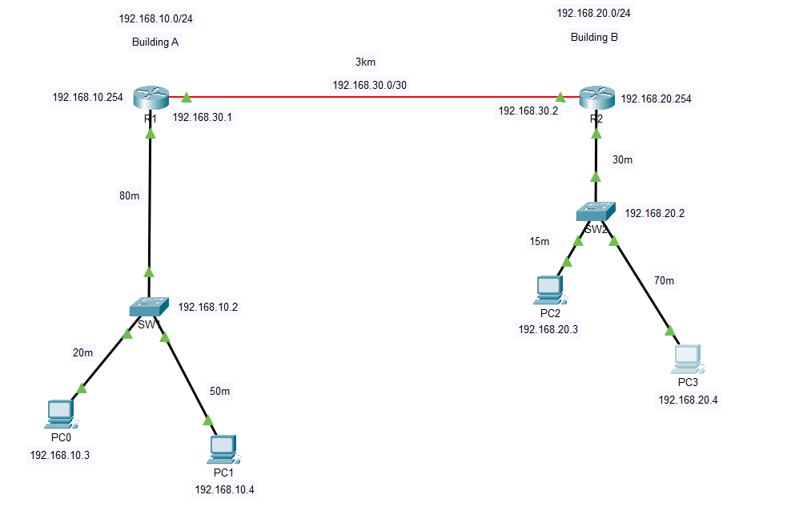

# Two-Building Office Network

A Cisco Packet Tracer project connecting two office buildings over a fibre link representing a distance of 3 km.

## Task

Configure a network connecting two office buildings, each containing:

- Two PCs
- One Cisco 2960 switch
- One Router-PT router

Provide connectivity between both buildings, configure basic device security and enable switch management across the network.

## Topology



The diagram shows the network design and addressing plan. Link indicators in this screenshot reflect the stage at which it was captured.

## IP Addressing

| Device | Interface/purpose | IP address | Subnet mask | Default gateway |
|---|---|---|---|---|
| R1 | Gi6/0 — fibre link | 192.168.30.1 | 255.255.255.252 | — |
| R1 | Gi7/0 — Building A LAN | 192.168.10.254 | 255.255.255.0 | — |
| SW1 | VLAN 1 management | 192.168.10.2 | 255.255.255.0 | 192.168.10.254 |
| PC0 | Building A | 192.168.10.3 | 255.255.255.0 | 192.168.10.254 |
| PC1 | Building A | 192.168.10.4 | 255.255.255.0 | 192.168.10.254 |
| R2 | Gi6/0 — fibre link | 192.168.30.2 | 255.255.255.252 | — |
| R2 | Gi7/0 — Building B LAN | 192.168.20.254 | 255.255.255.0 | — |
| SW2 | VLAN 1 management | 192.168.20.2 | 255.255.255.0 | 192.168.20.254 |
| PC2 | Building B | 192.168.20.3 | 255.255.255.0 | 192.168.20.254 |
| PC3 | Building B | 192.168.20.4 | 255.255.255.0 | 192.168.20.254 |

## Cabling and Distances

| Connection | Design distance | Cable type | Intended speed |
|---|---:|---|---|
| PC0 → SW1 | 20 m | Copper straight-through | 100 Mbps |
| PC1 → SW1 | 50 m | Copper straight-through | 100 Mbps |
| SW1 → R1 | 80 m | Copper straight-through | 1 Gbps |
| R1 → R2 | 3 km | Single-mode fibre | 1 Gbps |
| R2 → SW2 | 30 m | Copper straight-through | 1 Gbps |
| SW2 → PC2 | 15 m | Copper straight-through | 100 Mbps |
| SW2 → PC3 | 70 m | Copper straight-through | 100 Mbps |

The copper connections are within the 100 m channel limit for the Ethernet connections used.

Single-mode fibre was selected for the 3 km inter-building design. A physical installation would require compatible optics rated for that distance.

Router-PT modules used:

- PT-ROUTER-NM-1CGE for copper Gigabit Ethernet.
- PT-ROUTER-NM-1FGE for fibre Gigabit Ethernet.

Distances are design assumptions represented by labels in Packet Tracer.

## Configuration Completed

- Configured device hostnames.
- Assigned router interface addresses.
- Configured VLAN 1 management addresses on both switches.
- Configured switch default gateways.
- Configured PC addresses, subnet masks and default gateways.
- Enabled the required router interfaces.
- Configured static routes between buildings.
- Configured enable secrets.
- Configured console passwords and login.
- Enabled password obfuscation with `service password-encryption`.
- Added authorised-access banners.
- Saved device configurations.

## Static Routing

R1 forwards traffic for Building B through R2:

```text
ip route 192.168.20.0 255.255.255.0 192.168.30.2
```

R2 forwards traffic for Building A through R1:

```text
ip route 192.168.10.0 255.255.255.0 192.168.30.1
```

## Testing

The following tests succeeded during the lab:

| Test | Result |
|---|---|
| Communication within the local subnets | Passed |
| PC0 → its gateway, 192.168.10.254 | Passed |
| R1 → R2 fibre interface, 192.168.30.2 | Passed; 4/5 replies on initial attempt |
| PC-to-PC communication between buildings after adding routes | Passed |
| PC0 → SW2 management address, 192.168.20.2 | Passed |
| PC3 → SW1 management address, 192.168.10.2 | Passed |

Both connected interfaces on each router were verified as up/up using:

```text
show ip interface brief
```

## Troubleshooting

### Problem

Local subnet communication worked, but traffic could not reach the other building’s LAN.

### Investigation

1. Confirmed PC0 could reach its default gateway.
2. Checked router interface addresses and status.
3. Confirmed connectivity between the routers’ fibre interfaces.
4. Identified that routes to the remote LANs were missing.

### Resolution

Added a static route on each router pointing to the other router’s transit address.

Cross-building PC communication and switch management pings then succeeded.

### What I Learned

Routers automatically learn their active directly connected networks. They need additional routing information to reach remote networks.

Routes are needed for both the outgoing traffic and the return traffic.

A Layer 2 switch uses its default gateway for management traffic destined for another subnet.

## Scope

Manual speed/duplex configuration, unused switch-port shutdown and interface descriptions are planned for further practice and are not claimed as completed in this lab.

## Files

- `two-building-office-network.pkt` — Packet Tracer lab.
- `topology.png` — labelled network diagram.
